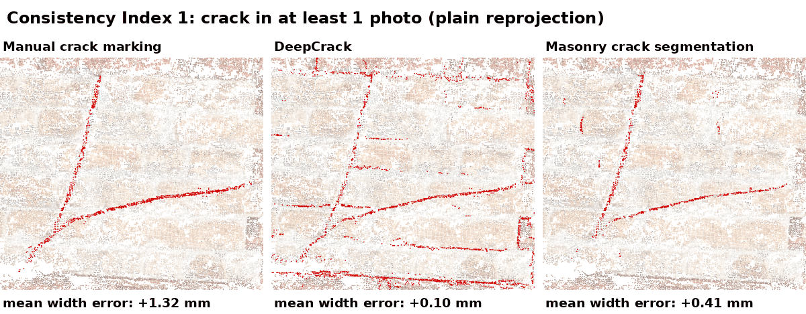

# consistency-index

Reprojection-based 3D crack identification with the **Consistency Index (CI)**: the minimum number of photos in which a point of a photogrammetric point cloud has to reproject onto a 2D crack segment to be labelled a crack point. CI = 1 is plain reprojection (one photo is enough). Raising the CI requires more photos to agree.

This repository contains the worked example of the accompanying manuscript: the point cloud, camera matrices and three 2D segmentations of its UAV dataset, cropped to the crack. It reproduces the CI point clouds and compares the CI with fixed fusion rules on the same point cloud and photos.

## UAV dataset

```
python code/run_drone_example.py   # CI clouds, rules, widths -> results/drone/widths.json
python code/make_figures.py        # results/drone/consistency_index_drone.gif
python code/prefilter.py           # comparison of the two pre-filtering stages
```

Inputs in `data/drone`: visible points of five photos after depth filtering and hidden point removal (local coordinates), camera matrices, binary masks of three segmentations (manual crack marking, DeepCrack, masonry crack segmentation), and the part centrelines and reference widths (3.00, 2.48 and 1.25 mm, crack ruler).



Each frame is one rule of the comparison below (CI 1, CI 2 and the fixed rules; CI 3 and CI 4 are in the table only). The three panels are the three 2D segmentations, each a front view of the crack region at true scale with the crack points kept by the rule in red, and the mean width error of each segmentation is given under its view.

### Comparison with fixed fusion rules

The rules run on the same points, photos and masks for all three segmentations. *Best view* keeps the label of one photo, chosen by distance or by viewing angle. *Fraction >= f* labels a point when at least a fraction f of the photos that see it agree, which is the decision made by colour averaging with a fixed colour interval. Score accumulation with a fixed constant is a single fixed CI value.

Mean width error in mm against the crack-ruler width, averaged over the parts measured at 8 or more of the 10 stations. **Bold**: the rule closest to the crack-ruler width for that segmentation.

| Rule | Manual crack marking | DeepCrack | Masonry crack segmentation |
|---|---|---|---|
| CI 1 (plain reprojection) | +1.32 | **+0.10** | +0.41 |
| CI 2 | +0.27 | −1.09 | −1.03 |
| CI 3 | −0.81 | −1.76 | −1.61 |
| CI 4 | −1.49 | −2.39 | −1.18 |
| Best view (closest photo) | **+0.15** | −0.72 | −0.57 |
| Best view (most frontal photo) | +0.38 | −0.97 | −0.61 |
| Fraction ≥ 1/3 | +1.01 | −0.12 | **−0.24** |
| Fraction ≥ 1/2 | +0.65 | −0.44 | −0.77 |
| Fraction ≥ 2/3 | −0.19 | −1.35 | −1.41 |

<details>
<summary>Width of each part (mm)</summary>

**Manual crack marking**

| Rule | Part 1 (3.00 mm) | Part 2 (2.48 mm) | Part 3 (1.25 mm) |
|---|---|---|---|
| CI 1 (plain reprojection) | 4.61 | 3.43 | 2.64 |
| CI 2 | 3.27 | 2.76 | 2.21 (5/10) |
| CI 3 | 2.09 | 1.78 | 1.09 (3/10) |
| CI 4 | 1.27 | 1.24 | – |
| Best view (closest photo) | 3.04 | 2.18 | 1.96 |
| Best view (most frontal photo) | 3.11 | 2.40 | 2.36 |
| Fraction ≥ 1/3 | 3.96 | 3.15 | 2.64 |
| Fraction ≥ 1/2 | 3.51 | 3.07 | 2.10 |
| Fraction ≥ 2/3 | 2.50 | 2.59 | 1.91 (7/10) |

**DeepCrack**

| Rule | Part 1 (3.00 mm) | Part 2 (2.48 mm) | Part 3 (1.25 mm) |
|---|---|---|---|
| CI 1 (plain reprojection) | 3.20 | 1.95 | 1.88 |
| CI 2 | 2.05 | 1.26 | 1.58 (5/10) |
| CI 3 | 0.94 | 1.02 | – |
| CI 4 | 0.61 | 0.65 (7/10) | – |
| Best view (closest photo) | 1.76 | 1.07 | 1.73 |
| Best view (most frontal photo) | 1.42 | 1.05 | 1.35 |
| Fraction ≥ 1/3 | 2.81 | 1.71 | 1.85 |
| Fraction ≥ 1/2 | 2.44 | 1.46 | 1.51 |
| Fraction ≥ 2/3 | 1.58 | 1.21 | 0.85 (5/10) |

**Masonry crack segmentation**

| Rule | Part 1 (3.00 mm) | Part 2 (2.48 mm) | Part 3 (1.25 mm) |
|---|---|---|---|
| CI 1 (plain reprojection) | 3.01 | 3.29 | – |
| CI 2 | 1.48 | 1.93 | – |
| CI 3 | 0.59 | 1.66 | – |
| CI 4 | 0.42 (4/10) | 1.30 | – |
| Best view (closest photo) | 2.33 | 2.01 | – |
| Best view (most frontal photo) | 2.28 | 1.98 | – |
| Fraction ≥ 1/3 | 2.51 | 2.49 | – |
| Fraction ≥ 1/2 | 1.65 | 2.30 | – |
| Fraction ≥ 2/3 | 0.70 | 1.95 | – |

(n/10): measured at only n of the 10 stations, not used in the mean error; –: fewer than 3 stations.

</details>

Part 3 (1.25 mm) is close to the point spacing of about 1 mm. At CI 2 and above, and under the 2/3 fraction, its crack points remain along only part of its length, so it is measured at 3 to 7 stations or not at all. The masonry segmentation did not segment Part 3 at any station in the photos.

The rule closest to the reference differed between the segmentations: the best view chosen by distance for manual marking (+0.15 mm), CI 1 for DeepCrack (+0.10 mm) and the 1/3 fraction for the masonry segmentation (−0.24 mm). This held in eight of nine variants of the width extraction (window ±3, ±6 or ±10 mm along the crack; band, full-extent or 10–90 % width). In all nine variants, each of the five fixed rules left at least one segmentation more than 0.5 mm from the reference, and in eight of them the same held for each fixed CI value.

**Width measurement.** Widths here are extracted automatically: at ten equally spaced stations along each part, the across-crack extent of the contiguous band of crack points within ±6 mm along the crack (`code/ci_pipeline.py`, `width`). A part is reported when at least 8 of the 10 stations can be measured; the manuscript's crack width table uses the same extraction and rule, and gives parts measured at 3 to 7 stations in brackets.

### Pre-filtering (depth filtering and hidden point removal)

`code/prefilter.py` is the pre-filtering applied to the point cloud for each photo before reprojection (manuscript, Section 2.2): depth filtering keeps the points that project inside the image and are no deeper than a threshold set for each photo, and hidden point removal (Open3D) then keeps the points visible from the camera centre. The settings of each photo are in `data/drone/prefilter.json`. The visible points in `data/drone` are the output of this step; the full point cloud is available on request. The crack points stored after each stage for four photos (`data/drone/prefilter_stages.npz`, manual crack marking) reproduce the comparison of the stages in the manuscript (Section 3.4):

| Four photos | On the tile surface | 10 to 50 mm off the surface, along the crack line | More than 50 mm off the surface |
|---|---|---|---|
| Depth filtering | 2796 | 482 | 52 |
| Depth filtering and hidden point removal | 1745 | 124 | 0 |

## Requirements

Python 3.10+, numpy, scipy, pillow; Open3D only for applying the pre-filtering to a full point cloud.
