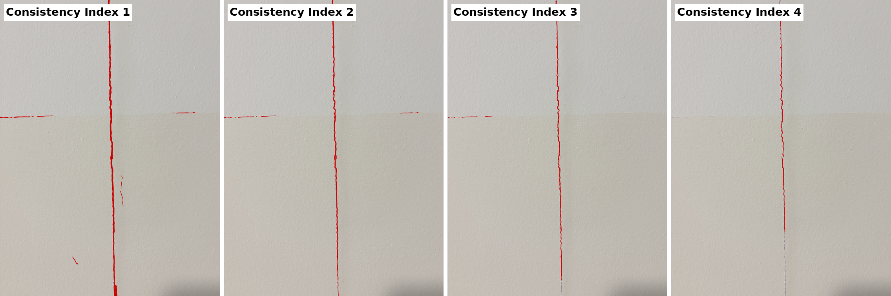

# consistency-index

Reprojection-based 3D crack identification with the **Consistency Index (CI)**: the minimum number of photos in which a point of a photogrammetric point cloud has to reproject onto a 2D crack segment to be labelled a crack point. CI = 1 is plain reprojection (one photo is enough). Raising the CI requires more photos to agree.

This repository contains two worked examples.

1. **UAV dataset (cropped):** the point cloud, camera matrices and three 2D segmentations used in the accompanying manuscript, cropped to the crack. It reproduces the CI point clouds and compares the CI with fixed fusion rules on the same point cloud and photos.
2. **Phone photos of a real hairline crack:** a general-purpose segmenter (SAM3, text prompt "crack") on five handheld photos, fused with the CI.

## 1. UAV dataset

```
python code/run_drone_example.py   # CI clouds, rules, widths -> results/drone/widths.json
python code/make_figures.py        # results/drone/rule_comparison.png, consistency_index_drone.gif
```

Inputs in `data/drone`: visible points of five photos after depth filtering and hidden point removal (local coordinates), camera matrices, binary masks of two segmentations (manual crack marking, DeepCrack), the CI clouds of a masonry crack network as produced by the original run, and the part centrelines and reference widths (3.00, 2.48 and 1.25 mm, crack ruler).


### Comparison with fixed fusion rules

The rules run on the same points, photos and masks for manual crack marking and DeepCrack. *Best view* keeps the label of one photo, chosen by distance or by viewing angle. *Fraction >= f* labels a point when at least a fraction f of the photos that see it agree, which is the decision made by colour averaging with a fixed colour interval. Score accumulation with a fixed constant is a single fixed CI value. The masks of the masonry run were not kept, so its CI clouds are included as produced (`data/drone/masonry_run_ci.npz`) and the fixed rules are not run for it.

Mean width error in mm (widths of Part 1 / Part 2 / Part 3 in brackets; – = too few points left to measure the part):

| Rule | Manual crack marking | DeepCrack | Masonry crack segmentation |
|---|---|---|---|
| CI 1 (plain reprojection) | +1.32 (4.61 / 3.43 / 2.64) | +0.10 (3.20 / 1.95 / 1.88) | -0.27 (2.17 / 2.77 / –) |
| CI 2 | +0.27 (3.27 / 2.76 / –) | -1.09 (2.05 / 1.26 / –) | -1.08 (1.34 / 1.98 / –) |
| CI 3 | -0.81 (2.09 / 1.78 / –) | -1.76 (0.94 / 1.02 / –) | -1.00 (– / 1.48 / –) |
| CI 4 | -1.49 (1.27 / 1.24 / –) | -2.39 (0.61 / – / –) | -1.32 (– / 1.16 / –) |
| best view (closest) | +0.15 (3.04 / 2.18 / 1.96) | -0.72 (1.76 / 1.07 / 1.73) | not run |
| best view (most frontal) | +0.38 (3.11 / 2.40 / 2.36) | -0.97 (1.42 / 1.05 / 1.35) | not run |
| fraction >= 1/3 | +1.01 (3.96 / 3.15 / 2.64) | -0.12 (2.81 / 1.71 / 1.85) | not run |
| fraction >= 1/2 | +0.65 (3.51 / 3.07 / 2.10) | -0.44 (2.44 / 1.46 / 1.51) | not run |
| fraction >= 2/3 | -0.19 (2.50 / 2.59 / –) | -1.35 (1.58 / 1.21 / –) | not run |


The rule closest to the reference differed between the two segmentations; the best view chosen by distance, for example, gave +0.15 mm for manual marking and −0.72 mm for DeepCrack. This held in eight of nine variants of the width extraction (window length 3, 6 or 10 mm; band, full-extent or 10–90 % width). Whether every fixed rule leaves at least one segmentation outside ±0.5 mm depends on the width definition (six of nine variants), so that is not claimed.

**Width measurement.** Widths here are extracted automatically: at ten equally spaced stations along each part, the across-crack extent of the contiguous band of crack points within ±6 mm along the crack (`code/ci_pipeline.py`, `width`). The widths in the manuscript's crack width table are CloudCompare readings, so the two sets of numbers are not identical.

## 2. Phone photos of a hairline crack

Five handheld photos of a crack on a painted wall (`data/phone/photos`). A sixth photo with a crack-width gauge (about 0.3 mm at the gauge) is kept aside as a reference (`data/phone/ground_truth`). Photo metadata was removed.

```
python code/phone/sam3_crack_tiled.py --images data/phone/photos --out data/phone/masks --ckpt sam3.pt   # GPU, SAM3
python code/phone/fuse.py --photos data/phone/photos --masks data/phone/masks --out results/phone/fused --ref 3
python code/phone/viz.py --fused results/phone/fused --ref-photo data/phone/photos/crack_04.jpg --out results/phone
```

The wall is planar, so each wall point is reprojected into every photo through the plane-induced homography estimated from SIFT matches. No 3D reconstruction is run in this example. Photo 2 did not reach the preset 300 inlier matches and was left out, so four photos are fused (registration error 2.6 to 3.5 px).



At CI 2, a scratch and small marks found in one photo only are removed. The paint boundary, detected in several photos, persists to CI 3. At CI 4 the crack thins and its lower part is lost.

## Requirements

Python 3.10+, numpy, scipy, pillow, matplotlib; opencv-python for the phone example; SAM3 (with its checkpoint) only to regenerate the phone masks.
