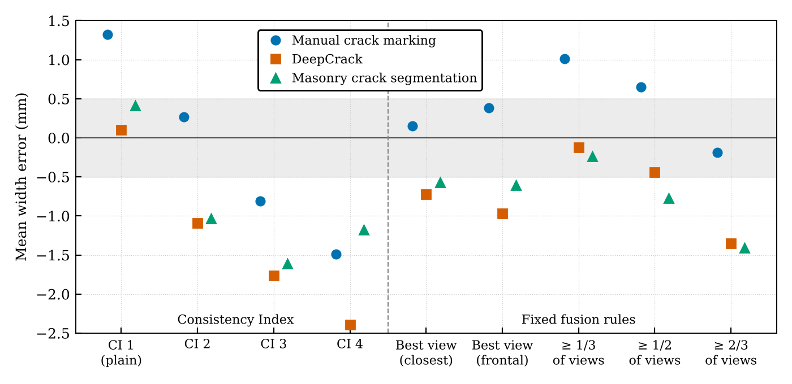

# consistency-index

Reprojection-based 3D crack identification with the **Consistency Index (CI)**: the minimum number of photos in which a point of a photogrammetric point cloud has to reproject onto a 2D crack segment to be labelled a crack point. CI = 1 is plain reprojection (one photo is enough). Raising the CI requires more photos to agree.

This repository contains the worked example of the accompanying manuscript: the point cloud, camera matrices and three 2D segmentations of its UAV dataset, cropped to the crack. It reproduces the CI point clouds and compares the CI with fixed fusion rules on the same point cloud and photos.

## UAV dataset

```
python code/run_drone_example.py   # CI clouds, rules, widths -> results/drone/widths.json
python code/make_figures.py        # results/drone/rule_comparison.png, consistency_index_drone.gif
```

Inputs in `data/drone`: visible points of five photos after depth filtering and hidden point removal (local coordinates), camera matrices, binary masks of three segmentations (manual crack marking, DeepCrack, masonry crack segmentation), and the part centrelines and reference widths (3.00, 2.48 and 1.25 mm, crack ruler).


Each frame is one rule, in the order of the comparison below. Red points are the crack points the rule keeps for each 2D segmentation; the mean width error of the three parts is given under each panel (0 = crack-ruler width).

### Comparison with fixed fusion rules

The rules run on the same points, photos and masks for all three segmentations. *Best view* keeps the label of one photo, chosen by distance or by viewing angle. *Fraction >= f* labels a point when at least a fraction f of the photos that see it agree, which is the decision made by colour averaging with a fixed colour interval. Score accumulation with a fixed constant is a single fixed CI value.

Mean width error in mm (widths of Part 1 / Part 2 / Part 3 in brackets; – = too few points left to measure the part):

| Rule | Manual crack marking | DeepCrack | Masonry crack segmentation |
|---|---|---|---|
| CI 1 (plain reprojection) | +1.32 (4.61 / 3.43 / 2.64) | +0.10 (3.20 / 1.95 / 1.88) | +0.41 (3.01 / 3.29 / –) |
| CI 2 | +0.27 (3.27 / 2.76 / –) | -1.09 (2.05 / 1.26 / –) | -1.03 (1.48 / 1.93 / –) |
| CI 3 | -0.81 (2.09 / 1.78 / –) | -1.76 (0.94 / 1.02 / –) | -1.61 (0.59 / 1.66 / –) |
| CI 4 | -1.49 (1.27 / 1.24 / –) | -2.39 (0.61 / – / –) | -1.18 (– / 1.30 / –) |
| best view (closest) | +0.15 (3.04 / 2.18 / 1.96) | -0.72 (1.76 / 1.07 / 1.73) | -0.57 (2.33 / 2.01 / –) |
| best view (most frontal) | +0.38 (3.11 / 2.40 / 2.36) | -0.97 (1.42 / 1.05 / 1.35) | -0.61 (2.28 / 1.98 / –) |
| fraction >= 1/3 | +1.01 (3.96 / 3.15 / 2.64) | -0.12 (2.81 / 1.71 / 1.85) | -0.24 (2.51 / 2.49 / –) |
| fraction >= 1/2 | +0.65 (3.51 / 3.07 / 2.10) | -0.44 (2.44 / 1.46 / 1.51) | -0.77 (1.65 / 2.30 / –) |
| fraction >= 2/3 | -0.19 (2.50 / 2.59 / –) | -1.35 (1.58 / 1.21 / –) | -1.41 (0.70 / 1.95 / –) |

How to read the figure: each column is one way of combining the five photos, and each marker is the mean width error of one segmentation (0 = crack-ruler width; grey band ±0.5 mm). From CI 1 to CI 4 the error falls for every segmentation.



The rule closest to the reference differed between the segmentations: the best view chosen by distance for manual marking (+0.15 mm), CI 1 for DeepCrack (+0.10 mm) and the 1/3 fraction for the masonry segmentation (−0.24 mm). This held in eight of nine variants of the width extraction (window ±3, ±6 or ±10 mm along the crack; band, full-extent or 10–90 % width).

**Width measurement.** Widths here are extracted automatically: at ten equally spaced stations along each part, the across-crack extent of the contiguous band of crack points within ±6 mm along the crack (`code/ci_pipeline.py`, `width`). The manuscript's crack width table uses the same extraction.

## Requirements

Python 3.10+, numpy, scipy, pillow, matplotlib.
